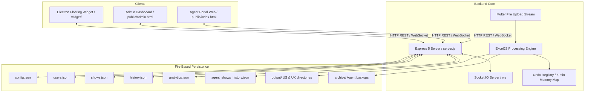
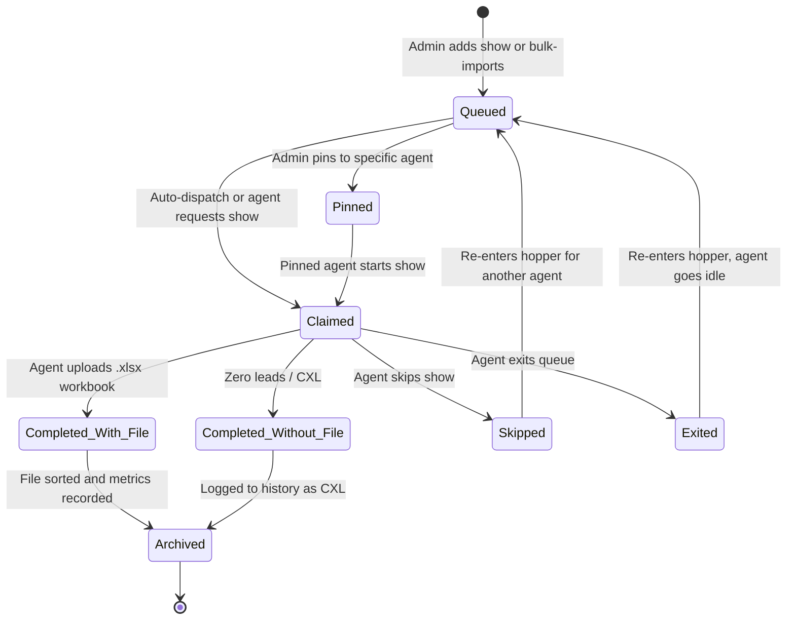

# ZORG NEXUS System Specification (`spec.md`)

## 1. Executive Summary & Product Overview

**ZORG NEXUS** (also known as **Z-Leads / Sorter**) is a real-time operations platform designed to orchestrate, dispatch, audit, and archive trade show exhibitor lead research. 

In trade show lead generation workflows, teams of researchers ("Agents") source exhibitor directory records for major domestic and international conferences, expos, and conventions. Zorg Nexus provides:
- A centralized **Hopper** (dispatch queue) managing incoming shows with automated round-robin or manual assignment.
- An **Agent Portal** with a live **Briefing Room** and interactive timer for agents executing research.
- An **Admin Operations Center** featuring real-time floor monitoring, hopper queue management, and deep analytics.
- An **Excel Auditing Engine** powered by `ExcelJS` that parses uploaded workbooks, audits visible vs. hidden rows, normalizes disqualification reason tags, automatically organizes files into regional directories (`US`/`UK`), and archives backups.
- A desktop **HUD Widget** built with Electron for distraction-free floating status tracking.
- An **Undo Registry** providing a 5-minute rolling window for transaction rollbacks.

---

## 2. System Architecture & Tech Stack



### Technology Matrix
- **Runtime Environment**: Node.js (CommonJS modules)
- **Web Framework**: Express 5.2.1
- **Real-Time Communication**: Socket.IO 4.8.3
- **Spreadsheet Processing**: ExcelJS 4.4.0
- **File Upload Middleware**: Multer 2.1.1
- **Desktop Framework**: Electron 43.3.0
- **Client Technology**: Vanilla HTML5 / ES6 JavaScript / Modern CSS Glassmorphism / Chart.js 4.4.2
- **Host Platform**: Windows 10/11 (with VBScript background launchers `ZORG.vbs`, `WIDGET.vbs`, `Run.vbs`)

---

## 3. Data Models & File Storage Schemas

All persistence is file-based JSON stored in the project root directory. Missing files are automatically initialized on startup by the bootstrap routine.

### 3.1 `config.json`
Stores core system paths and filtering configuration.
```json
{
  "tempZone": "C:\\...\\temp",
  "usBase": "C:\\...\\output\\US",
  "ukBase": "C:\\...\\output\\UK",
  "cxlTags": ["Pricing", "Duplicates", "SameList"],
  "useManualDestFolder": false,
  "manualDestFolder": ""
}
```

### 3.2 `users.json`
Stores credentials, system roles, user themes, and per-user archive root paths.
```json
[
  {
    "username": "Yahia",
    "password": "...",
    "role": "Admin",
    "archivePath": "C:\\...\\archive",
    "theme": "dark"
  },
  {
    "username": "AgentName",
    "password": "...",
    "role": "Agent",
    "archivePath": "C:\\...\\archive",
    "theme": "light"
  }
]
```

### 3.3 `shows.json`
The central queue of trade shows.
```json
[
  {
    "id": "ms36pkz2igas1siyb",
    "showName": "XShow - HR Tech 2026 - October 20-22, 2026 - Las Vegas, NV, USA",
    "cleanName": "HR Tech 2026",
    "country": "US",
    "priority": 1,
    "link": ["https://exhibitors.hrtechconference.com"],
    "details": "Research all exhibitors under Hall A & B.",
    "agentName": "Yahia",
    "pinnedTo": "Yahia",
    "status": "In Progress",
    "dateAdded": "2026-10-29T18:00:00.000Z",
    "startedAt": "2026-10-29T18:30:00.000Z",
    "completedAt": null
  }
]
```

### 3.4 `history.json`
Maintains recent upload audit records and system events (capped at 500 entries each).
```json
{
  "files": [
    {
      "agent": "Yahia",
      "name": "XShow - HR Tech 2026 - Las Vegas.xlsx",
      "size": 66651,
      "mtime": "2026-10-29T09:00:00.000Z",
      "uploadTime": 1793297766079,
      "region": "USA",
      "destPath": "2026/Oct/29-10",
      "status": "sorted",
      "transactionId": "mvtv6s2b63jd8183z"
    }
  ],
  "logs": [
    {
      "time": "2026-10-29 21:15:00",
      "agent": "Yahia",
      "action": "Upload",
      "details": "Processed HR Tech 2026 (120 shown, 15 hidden)"
    }
  ]
}
```

### 3.5 `analytics.json`
Ledger partitioned by date (`YYYY-MM-DD`) tracking lead counts, file counts, and reason distributions.
```json
{
  "2026-10-29": {
    "summary": {
      "totalFiles": 12,
      "totalLeads": 1450,
      "totalShown": 1320,
      "byAgent": {
        "Yahia": { "files": 8, "leads": 980, "shown": 910 },
        "Ammar": { "files": 4, "leads": 470, "shown": 410 }
      }
    },
    "records": [
      {
        "transactionId": "mvtv6s2b63jd8183z",
        "agent": "Yahia",
        "filename": "XShow - HR Tech 2026 - Las Vegas.xlsx",
        "mode": "standard",
        "shown": 120,
        "hidden": 15,
        "total": 135,
        "hiddenReasons": { "Int'l": 8, "NF": 4, "Repeated": 3 },
        "time": "21:15:00",
        "timestamp": 1793297766079,
        "note": ""
      }
    ]
  }
}
```

### 3.6 `agent_shows_history.json`
Tracks the historical show completions and cancellations for performance evaluation.

---

## 4. Core Subsystems & Workflows

### 4.1 Show Hopper & Dispatch Lifecycle



1. **Auto-Dispatch**: When enabled (`isAutoDispatch = true`), requesting `/api/shows/next` automatically queries the hopper, finds the highest-priority unassigned show, marks it `In Progress`, pins it to the requesting agent, and broadcasts a WebSocket floor update.
2. **Pinned Shows**: If a show is specifically pinned to an agent by the Admin (`pinnedTo: username`), it will only be dispatched to that agent.
3. **Skip & Exit Queue**: Agents can skip a show (`/api/shows/skip`) to re-queue it and automatically receive the next available show, or exit the queue (`/api/shows/exit-queue`) to return the show and return their floor status to `Idle`.

### 4.2 Floor Management & Real-Time Presence
The server maintains an in-memory `activeFloor` dictionary:
- **Statuses**: `working`, `idle`, `break`, `lunch`, `emergency`, `offline`.
- **Timer**: Whenever an agent claims a show, a server-tracked session timer starts.
- **Heartbeat & Disconnects**: Agents disconnecting gracefully notify the server; socket drops trigger state updates across all connected Admin and Agent dashboards.

### 4.3 Excel Auditing & Lead Processing Engine

The core data integrity pipeline resides in `/api/upload` and `/api/upload-bulk`:
1. **Multer Staging**: Uploaded `.xlsx` files land in `config.tempZone`.
2. **ExcelJS Inspection**:
   - Inspects worksheet rows starting from the header (auto-detecting column headers: Company, Phone, Website, Reason, Country, etc.).
   - Distinguishes **Visible Rows** (counted as `shown` leads) from **Hidden Rows** (counted as `hidden` leads). A row is marked hidden if Excel's `row.hidden === true` or row height is zero.
3. **Reason Normalization (`normalizeReason`)**:
   Hidden rows are inspected for disqualification tags and mapped to canonical values:
   - `Int'l` (aliases: international, intl, int'l)
   - `Publisher` (aliases: publishing, puplishing, publisher)
   - `CXL` (aliases: cancel, canceled, cancelled)
   - `NF` (aliases: n/f, not found, not-found)
   - `No Num` (aliases: no number, no phone, no #, no-num)
   - `Repeated` (aliases: repeat, duplicate, dup)
   - `Local` (aliases: local company)
   - `Blank` / `Invalid Reason`
4. **File Routing & Partitioning**:
   Files are saved according to convention:
   ```
   output/[US|UK]/[YYYY]/[MonthName]/[DD-MM]/[ShowFilename].xlsx
   ```
   A duplicate copy is archived to the agent's individual folder:
   ```
   archive/[AgentUsername]/[YYYY]/[MonthName]/[DD-MM]/[ShowFilename].xlsx
   ```
5. **Ledger Recording**:
   Metrics are appended to `history.json` and `analytics.json`.

### 4.4 The 5-Minute Undo Registry
- Any successful upload generates a unique `transactionId`.
- An entry in `undoRegistry` stores:
  - Destination file path
  - Archive file path
  - Previous `history.json` snapshot
  - Previous `analytics.json` snapshot
  - Previous `shows.json` status
- If `/api/undo` is called within 5 minutes (300,000 ms), the server deletes the created files, restores the previous analytics/history state, and returns the show to the active hopper.
- Expired transactions are swept from memory every 60 seconds.

### 4.5 Electron Floating Widget
- Launched via `WIDGET.vbs` (`widget/main.js`).
- Creates a lightweight, borderless, always-on-top window (`widget.html`).
- Displays the current show name, real-time timer, quick "Copy Name" button, and direct action triggers (Skip, Complete).
- Communicates via Socket.IO directly to `http://localhost:3005`.

---

## 5. API Reference Table

| Method | Endpoint | Description | Auth / Role |
|---|---|---|---|
| `POST` | `/api/login` | Authenticates username/password; returns user profile and permissions | Public |
| `GET` | `/api/user/profile` | Fetches active user data, role, and custom settings | Authenticated |
| `POST` | `/api/user/theme` | Saves user theme preference (`light` or `dark`) | Authenticated |
| `GET` | `/api/user/data` | Fetches personal metrics, recent files, and daily stats | Authenticated |
| `GET` | `/api/user/report` | Generates summary report for the logged-in agent | Authenticated |
| `POST` | `/api/record/note` | Appends a note to a transaction in analytics | Authenticated |
| `GET` | `/api/shows` | Returns all shows in the hopper | Authenticated |
| `GET` | `/api/shows/next` | Dispatches the next available show to the requesting agent | Agent |
| `GET` | `/api/shows/active` | Retrieves the show currently assigned to the agent | Agent |
| `POST` | `/api/shows/add` | Adds a new show to the hopper | Admin |
| `POST` | `/api/shows/upload` | Bulk-imports shows from an uploaded Excel spreadsheet | Admin |
| `POST` | `/api/shows/update` | Updates fields on an existing show | Admin |
| `POST` | `/api/shows/bulk-update`| Batch updates priority or assignment for shows | Admin |
| `POST` | `/api/shows/reorder` | Updates hopper queue order | Admin |
| `POST` | `/api/shows/assign` | Manually assigns or pins a show to an agent | Admin |
| `POST` | `/api/shows/complete` | Marks a show completed without an uploaded file | Agent |
| `POST` | `/api/shows/skip` | Re-queues current show and returns next show | Agent |
| `POST` | `/api/shows/exit-queue`| Re-queues current show and resets agent to Idle | Agent |
| `POST` | `/api/shows/cancel` | Flags a show as cancelled | Admin |
| `POST` | `/api/shows/clear` | Purges completed or all shows from the hopper | Admin |
| `GET` | `/api/shows/export` | Exports the show hopper into an Excel report | Admin |
| `POST` | `/api/upload` | Processes and sorts a single trade show workbook | Agent |
| `POST` | `/api/upload-bulk` | Processes and sorts up to 20 workbooks simultaneously | Agent |
| `POST` | `/api/undo` | Rolls back an upload transaction within 5 minutes | Authenticated |
| `GET` | `/api/analytics` | Returns aggregated daily/monthly stats & ledger records | Authenticated |
| `POST` | `/api/shows/status` | Updates agent floor status (Idle, Working, Break, etc.) | Authenticated |

---

## 6. Socket.IO Real-Time Events

| Event Name | Direction | Payload | Description |
|---|---|---|---|
| `floorUpdate` | Server -> All | `activeFloor` dictionary | Broadcasts live status, timers, and active shows of all agents |
| `agentStatusChange` | Client -> Server | `{ agent, status }` | Emitted when an agent changes status (Break, Lunch, etc.) |
| `queueUpdate` | Server -> All | `{ count }` | Broadcasts changes to the hopper queue count |
| `showAssigned` | Server -> Client | `{ show }` | Notifies a specific agent that a show was assigned to them |
| `serverShutdown` | Server -> All | `{ message }` | Emitted when Admin initiates server shutdown |

